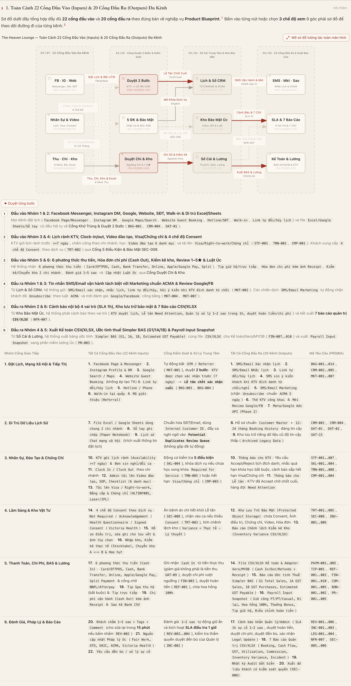

# The Heaven Lounge (Spa Úc) — Toàn Bộ 22 Cổng Đầu Vào, 7 Luồng Vận Hành Liên Kết & 20 Cổng Đầu Ra Trên 1 Trang Duy Nhất

> **1 Trang Tương Tác Duy Nhất (`index.html`) · Sẵn Sàng Đẩy Lên Vercel (`vercel.json`) · 100% Tiếng Việt (`0` chữ tiếng Trung) · 22 Cổng Đầu Vào (Facebook, Instagram, Google, Web, SĐT, Walk-in, Excel, Video, Visa, 4 Consent, 6 Kênh Thu, Chi Phí, Kho) · 7 Luồng Liên Kết Khép Kín · 20 Cổng Đầu Ra (SMS/Email, Marketing ACMA, BAS G1/1A/1B, Lương Úc, 7 Báo Cáo CSV/XLSX) · 12 Sơ Đồ Archify Tương Tác**
>
> **Cơ sở áp dụng:** **Brunswick (`3056`)** & **North Melbourne (`3051`)** — Melbourne, Victoria, Australia  
> **Chuẩn pháp lý Úc:** Fair Work `[MA000005]` (Hair and Beauty Industry Award) · `ATO Simpler BAS (G1/1A/1B)` · `OAIC Privacy Act 1988` · `ACMA Spam Act 2003` · `Victoria Health (Skin Penetration & Laser/IPL)`

---

## 🚀 Đẩy Lên Vercel Trong 10 Giây (Đã Cấu Hình Sẵn `vercel.json` + `index.html`)

Thư mục này đã được chuẩn hóa cấu trúc **Static Root (`index.html` + `vercel.json` + `package.json` + `.vercelignore`)** để đẩy thẳng lên **Vercel** mà **không cần cấu hình tay bất kỳ thông số nào**:

### Cách 1: Bấm 1-Click Deploy hoặc Import từ GitHub trên Web Vercel (Khuyên dùng)
1. Bấm nút dưới đây (hoặc mở [**https://vercel.com/new**](https://vercel.com/new)):  
   [](https://vercel.com/new/clone?repository-url=https%3A%2F%2Fgithub.com%2Ftipovuhoa26-sudo%2Fspa-uc-archify&project-name=spa-uc-archify&repository-name=spa-uc-archify)
2. Chọn kho mã nguồn **`tipovuhoa26-sudo/spa-uc-archify`** và bấm nút **Deploy** (Vercel tự nhận `vercel.json` và dùng `index.html` làm trang chủ `/`).

### Cách 2: Đẩy trực tiếp từ Terminal máy Mac bằng 1 lệnh
```bash
cd /Users/hungnpv/Downloads/Sunext/Sunext-Agent-GG/spa-uc-archify && npx vercel --prod
```

---

## 🌐 Mở Ngay Trang Tương Tác Hợp Nhất Duy Nhất (1-Click)

| Trang Hợp Nhất Duy Nhất | Nội Dung Tích Hợp Trên 1 Trang | Mở Trực Tiếp Trên Trình Duyệt | Mã Nguồn HTML |
| :--- | :--- | :--- | :--- |
| **Toàn Bộ 22 Cổng Đầu Vào, 7 Luồng Liên Kết & 20 Cổng Đầu Ra (`index.html`)** | Hợp nhất **toàn bộ 22 Cổng Đầu Vào (`Facebook Messenger`, `Instagram DM`, `Google/Web`, `SĐT`, `Walk-in`, `Di trú Excel/Sheets`, `Lịch rảnh KTV`, `Video đào tạo`, `Visa/Chứng chỉ`, `4 chế độ Consent`, `6 phương thức thu ngân`, `Chi phí Cash Out`, `Kiểm kê kho`, `Review 1–5★`, `Luật Úc`)**, **7 Luồng Vận Hành Liên Kết (`Duyệt 2 Bước: KTV -> Lễ tân chốt cuối BKG-004`)**, và **20 Cổng Đầu Ra (`SMS/Email vận hành`, `Marketing chuẩn ACMA`, `Mời Review Google/FB`, `Cảnh báo SLA 1h`, `Ước tính BAS G1/1A/1B`, `Payroll Input Snapshot`, `7 Báo cáo CSV/XLSX`)** trong **1 trang duy nhất**. | [**👉 BẤM ĐỂ MỞ TRANG HỢP NHẤT DUY NHẤT (`index.html`)**](https://tipovuhoa26-sudo.github.io/spa-uc-archify/) | [`index.html`](./index.html) · [`17-spa-uc-omnichannel-io-dataflow.html`](./17-spa-uc-omnichannel-io-dataflow.html) |


---

## 🔌 Ma Trận Đầy Đủ 22 Cổng Đầu Vào (Inputs) & 20 Cổng Đầu Ra (Outputs)

| Nhóm Cổng Giao Tiếp | Tất Cả Cổng Đầu Vào (22 Kênh Inputs) | Cổng Kiểm Soát & Xử Lý Trung Tâm | Tất Cả Cổng Đầu Ra (20 Kênh Outputs) | Mã Yêu Cầu (PRD/BA) |
| :--- | :--- | :--- | :--- | :--- |
| **1. Đặt Lịch, Mạng Xã Hội & Tiếp Thị** | **1.** `Facebook Page & Messenger` · **2.** `Instagram Profile & DM` · **3.** `Google Search / Maps` · **4.** `Website Guest Booking` (không ép tạo TK) & `Link tự đổi/hủy lịch` · **5.** `Hotline / Phone` · **6.** `Walk-in tại quầy` & `Mã giới thiệu (Referral)` | Tự động bắt `UTM / Referrer` (`MKT-001`), duyệt **2 bước**: `KTV được chọn xác nhận trước (tối đa trước 7 ngày)` ➔ **`Lễ tân luôn là người chốt xác nhận cuối`** (`BKG-003`, `BKG-004`) | **1.** `SMS/Email Xác nhận lịch` · **2.** `SMS/Email Nhắc lịch` · **3.** `Link tự đổi/hủy lịch` · **4.** `SMS xin ý kiến khách khi KTV đích danh từ chối/nghỉ` · **5.** `SMS/Email Marketing` (chặn `Unsubscribe` chuẩn `ACMA 5 ngày`) · **6.** `Thẻ KTV công khai` & `Mời Review Google/FB` · **7.** `Meta/Google Ads API (Phase 2)` | `BKG-001..014`, `CRM-002..005`, `MKT-001..007` |
| **2. Di Trú Dữ Liệu Lịch Sử** | **7.** `File Excel / Google Sheets dùng chung 2 chi nhánh` · **8.** `Sổ tay ghi chép (Paper Notebook)` · **9.** `Lịch sử Chat mạng xã hội` (trích xuất thông tin đặt lịch) | Chuẩn hóa SĐT/Email, dùng `Internal Customer ID`, đẩy ca nghi ngờ vào **`Potential Duplicates Review Queue`** (không gộp đè tự động) | **8.** Hồ sơ chuẩn `Customer Master` + `12–24 tháng Booking History` đáng tin cậy · **9.** Kho lưu trữ riêng dữ liệu cũ độ tin cậy thấp (`Archived Legacy Data`) | `CRM-001`, `CRM-004`, `DAT-01`, `DAT-02`, `UAT-15` |
| **3. Nhân Sự, Đào Tạo & Chứng Chỉ** | **10.** `KTV gửi lịch rảnh (Availability >=7 ngày)` & `Đơn xin nghỉ/đổi ca` · **11.** `Clock In / Clock Out` theo chi nhánh · **12.** `Admin tải lên Video đào tạo, SOP, Checklist (6 danh mục)` · **13.** `Tải lên Visa / Right-to-work, Bằng cấp & Chứng chỉ (HLTINF005, Laser/IPL)` | Động cơ kiểm tra **5 điều kiện** (`SKL-004`), khóa dịch vụ nếu chưa học xong khóa `Required for Service` (`TRN-005`) hoặc hết hạn `Visa/Chứng chỉ` (`CMP-003`) | **10.** `Thông báo cho KTV`: Yêu cầu Accept/Reject lịch đích danh, nhắc quá hạn khóa học bắt buộc, cảnh báo sắp hết hạn Visa/Chứng chỉ · **11.** `Thông báo cho Lễ tân`: KTV đã Accept chờ chốt cuối, hàng đợi `Need Attention` | `STF-001..007`, `SKL-001..004`, `TRN-001..008`, `CMP-001..004` |
| **4. Lâm Sàng & Kho Vật Tư** | **14.** `4 chế độ Consent theo dịch vụ`: `Not Required` / `Acknowledgement` / `Health Questionnaire` / `Signed Consent` (`Victoria Health`) · **15.** `Hồ sơ điều trị, sửa ghi chú lưu vết & ảnh tùy chọn` · **16.** `Nhập kho, Kiểm kê thực tế (Stocktake), Chuyển kho A <-> B & Hao hụt` | Ẩn bệnh án chi tiết khỏi Lễ tân (`SEC-008`), chặn vào ca nếu thiếu `Consent` (`TRT-003`), tính chênh lệch kho (`Variance = Thực tế − Lý thuyết`) | **12.** `Kho Lưu Trữ Bảo Mật (Protected Object Storage)` chứa Consent, Ảnh điều trị, Chứng chỉ, Video, Hóa đơn · **13.** `Báo cáo Chênh lệch Kiểm kê Kho (Inventory Variance CSV/XLSX)` | `TRT-001..005`, `SEC-008`, `INV-001..006` |
| **5. Thanh Toán, Chi Phí, BAS & Lương** | **17.** `6 phương thức thu tiền (Cash In)`: `Card/EFTPOS, Cash, Bank Transfer, Online, Apple/Google Pay, Split Payment` & cổng chờ `BNPL/Afterpay` · **18.** `Tip Spa thu hộ` (bắt buộc) & `Tip trực tiếp` · **19.** `Chi phí vận hành (Cash Out) kèm ảnh Receipt` & `Sao kê Bank CSV` | Ghi nhận `Cash In` từ tiền thực thu (giảm giá không phải là tiền thu `UAT-09`), duyệt chi phí vượt ngưỡng (`FIN-003`), duyệt hoàn tiền (`REF-001`), chia hoa hồng `100%` | **14.** `File CSV/XLSX Kế toán & Adapter Xero/MYOB` (`Cash In/Out/Refunds + Receipt`) · **15.** `Báo cáo Ước tính Thuế Simpler BAS` (`G1 Total Sales, 1A GST Sales, 1B GST Purchases, Estimated GST Payable`) · **16.** `Payroll Input Snapshot` (`Giờ công FT/PT/Casual, Đi lại, Hoa hồng 100%, Thưởng Bonus, Tip giữ hộ, Điều chỉnh hoàn tiền`) | `PAYM-001..005`, `TIP-001`, `REF-001..003`, `FIN-001..010`, `COM-001..005`, `BON-001..002`, `PR-001..005` |
| **6. Đánh Giá, Pháp Lý & Báo Cáo** | **20.** `Khách chấm 1–5 sao + Tags + Comment` (cho sửa lại trong **15 phút** nếu bấm nhầm `REV-002`) · **21.** `Nguồn cập nhật Pháp lý Úc` (`Fair Work, ATO, OAIC, ACMA, Victoria Health`) · **22.** `Yêu cầu đền bù / xử lý sự cố` | Đánh giá `1–2 sao` tự động giữ ẩn và kích hoạt **SLA điều tra 1 giờ** (`REV-003..004`), kiểm tra thẩm quyền duyệt đền bù của Quản lý (`INC-002`) | **17.** `Cảnh báo khẩn Quản lý/Admin` (`SLA 1h sự cố 1–2 sao`, duyệt hoàn tiền, duyệt chi phí, duyệt đền bù, xác nhận `Legal Update`) · **18.** `7 Báo cáo Quản trị CSV/XLSX` (`Booking, Cash Flow, GST, Utilisation, Commission, Inventory Variance, Incident`) · **19.** `Nhật ký Audit bất biến` · **20.** `Xuất dữ liệu khách có kiểm soát quyền (SEC-006)` | `REV-001..006`, `INC-001..003`, `LEG-001..004`, `NFR-007`, `SEC-005..006` |



---

## 🗺️ Xem Trực Tiếp 7 Mục Liên Kết Trên Trang Hợp Nhất (`index.html`)

### Mục 1. Toàn Cảnh 22 Cổng Đầu Vào (Inputs) & 20 Cổng Đầu Ra (Outputs) Đa Kênh
- **Mở trực tiếp trên trang hợp nhất:** [**Mục 1 — 22 Cổng Đầu Vào & 20 Cổng Đầu Ra (`#he-sinh-thai-22-cong-dau-vao-20-cong-dau-ra`)**](https://tipovuhoa26-sudo.github.io/spa-uc-archify/#he-sinh-thai-22-cong-dau-vao-20-cong-dau-ra)

### Mục 2. Bản Đồ Liên Kết Tổng Thể 7 Luồng & Bảng Móc Xích Chuyển Giao (`Hard Gates`)
- **Mở trực tiếp trên trang hợp nhất:** [**Mục 2 — Bản Đồ Liên Kết 7 Luồng (`#ban-do-lien-ket-7-luong`)**](https://tipovuhoa26-sudo.github.io/spa-uc-archify/#ban-do-lien-ket-7-luong)


### Mục 3. Luồng 1, 2 & 3 Liên Kết: Đào Tạo & Xếp Ca (Tram 45p) ➔ Đặt Lịch 6 Kênh (`FB/IG/Web`) & Duyệt 2 Bước ➔ Cấp Cứu Nghỉ Đột Xuất
- **Mở trực tiếp trên trang hợp nhất:** [**Mục 3 — Luồng 1, 2 & 3 Liên Kết (`#luong-1-2-3-xep-ca-dat-lich-cap-cuu`)**](https://tipovuhoa26-sudo.github.io/spa-uc-archify/#luong-1-2-3-xep-ca-dat-lich-cap-cuu)


### Mục 4. Luồng 4 & 5 Liên Kết: Check-In Bảo Mật (`SEC-008`) & 4 Chế Độ Consent (`TRT-002`) ➔ Điều Trị Lưu Vết, Ảnh Tùy Chọn & Kiểm Kê Kho 2 Chi Nhánh
- **Mở trực tiếp trên trang hợp nhất:** [**Mục 4 — Luồng 4 & 5 Liên Kết (`#luong-4-5-checkin-consent-tai-giuong`)**](https://tipovuhoa26-sudo.github.io/spa-uc-archify/#luong-4-5-checkin-consent-tai-giuong)


### Mục 5. Luồng 6 Liên Kết: 6 Phương Thức Thanh Toán (`Cash In`), Chi Phí Hóa Đơn (`Cash Out`), Hoàn Tiền, GST/BAS (`G1/1A/1B`) & Hoa Hồng `100%`
- **Mở trực tiếp trên trang hợp nhất:** [**Mục 5 — Luồng 6 Thu Ngân, Chi Phí & BAS (`#luong-6-thu-ngan-6-buoc-gst-hoa-hong`)**](https://tipovuhoa26-sudo.github.io/spa-uc-archify/#luong-6-thu-ngan-6-buoc-gst-hoa-hong)


### Mục 6. Luồng 7 Liên Kết & Khép Vòng Lặp: Đánh Giá `1–5 Sao` (Sửa Trong `15p`), SLA Sự Cố `1 Giờ`, Marketing Chuẩn `ACMA` & Cập Nhật Pháp Lý Úc
- **Mở trực tiếp trên trang hợp nhất:** [**Mục 6 — Luồng 7 Hậu Mãi, Marketing ACMA & Pháp Lý (`#luong-7-hau-mai-sla-xero-payroll`)**](https://tipovuhoa26-sudo.github.io/spa-uc-archify/#luong-7-hau-mai-sla-xero-payroll)


### Mục 7. Xương Sống Kiến Trúc & Dữ Liệu Liên Kết Toàn Hệ Thống: 8 Bảng CSDL (`ERD`), 17 Màn Hình (`Tree`) & Kiến Trúc Đích (`Architecture`)
- **Mở trực tiếp trên trang hợp nhất:** [**Mục 7 — Kiến Trúc, ERD & 17 Màn Hình Liên Kết (`#kien-truc-du-lieu-va-17-man-hinh-lien-ket`)**](https://tipovuhoa26-sudo.github.io/spa-uc-archify/#kien-truc-du-lieu-va-17-man-hinh-lien-ket)


---

## 🛠️ Kiểm Tra Chất Lượng Tự Động (`archify finalize`)

- **0 ký tự tiếng Trung (`0` matches cho `[\u4e00-\u9fff]`)** trên toàn bộ giao diện, sơ đồ, chú giải và thanh công cụ.
- **0 lỗi Schema / Layout / Prose & `browser-check: pass`** trên Chromium Headless (`12/12` sơ đồ tương tác nhúng trực tiếp trong 1 trang duy nhất).
