# The Heaven Lounge (Spa Úc) — Cẩm Nang Trực Quan 7 Luồng Vận Hành & 17 Hồ Sơ Kiến Trúc (Archify v3.2.0)

> **BẤM ĐỂ MỞ TRỰC TIẾP TRÊN TRÌNH DUYỆT (LIVE INTERACTIVE VIEWER — HTTP 200 TỨC THÌ):**
> 1. **[MỞ CẨM NANG TƯƠNG TÁC 7 LUỒNG VẬN HÀNH TỪ A ĐẾN Z (`Explainer 15`) ↗](https://htmlpreview.github.io/?https://github.com/tipovuhoa26-sudo/spa-uc-archify/blob/main/15-spa-uc-7-luong-van-hanh-toan-dien-explainer.html)**
> 2. **[MỞ BẢN ĐỒ TỔNG THỂ 7 LUỒNG KHÉP KÍN TRÊN 1 MÀN HÌNH (`Master Workflow 16`) ↗](https://htmlpreview.github.io/?https://github.com/tipovuhoa26-sudo/spa-uc-archify/blob/main/16-spa-uc-master-end-to-end-workflow.html)**
> 3. **[MỞ TỔNG QUAN CHIẾN LƯỢC BUILD VS BUY & 19 NGUYÊN TẮC (`Explainer 00`) ↗](https://htmlpreview.github.io/?https://github.com/tipovuhoa26-sudo/spa-uc-archify/blob/main/00-spa-uc-tong-quan-kien-truc-tieng-viet-explainer.html)**

---

## I. Bức Tranh Toàn Cảnh: Toàn Bộ 7 Luồng Vận Hành Của Spa Hoạt Động Ra Sao?

Hãy hình dung **1 ngày vận hành thực tế** tại 2 chi nhánh **Brunswick (`550 Sydney Rd, VIC 3056`)** và **North Melbourne (`342 Victoria St, VIC 3051`)** với đội ngũ 6–7 Kỹ thuật viên (`Việt / Anh / Thái`). Toàn bộ hoạt động của spa chạy theo **1 đường ống khép kín gồm 7 luồng nối tiếp nhau** (chia làm 3 chặng: **Trước khi khách đến → Trong khi khách ở Spa → Khi thanh toán & Quản trị**):

[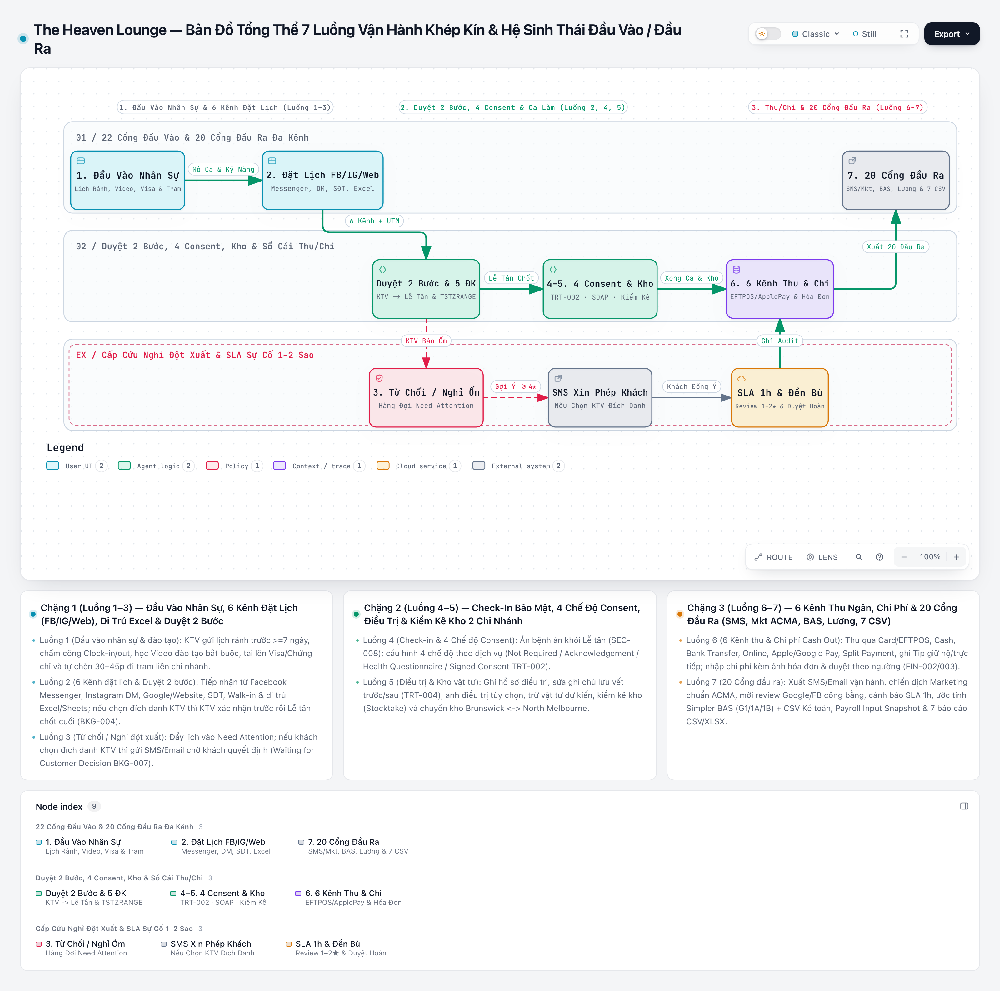](https://htmlpreview.github.io/?https://github.com/tipovuhoa26-sudo/spa-uc-archify/blob/main/16-spa-uc-master-end-to-end-workflow.html)

[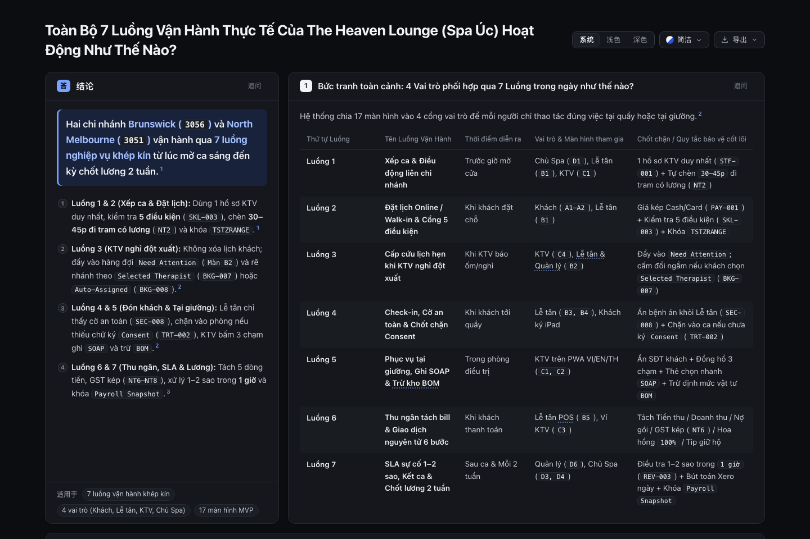](https://htmlpreview.github.io/?https://github.com/tipovuhoa26-sudo/spa-uc-archify/blob/main/15-spa-uc-7-luong-van-hanh-toan-dien-explainer.html)

### Bảng Tóm Tắt 7 Luồng Theo Vai Trò & Màn Hình (Ai Làm Gì, Ở Đâu, Hệ Thống Chặn Gì?)

| Luồng | Chặng | Ai Thao Tác? (Màn Hình) | Chuyện Gì Diễn Ra Trong Thực Tế? | Chốt Chặn Tự Động Của Hệ Thống | Sơ Đồ Chi Tiết |
| :--- | :--- | :--- | :--- | :--- | :--- |
| **Luồng 1** | Trước giờ mở cửa | Chủ Spa (`D1`), Lễ tân (`B1`), KTV (`C1`) | **Xếp ca & Điều động liên chi nhánh:** Mỗi KTV chỉ có **1 hồ sơ duy nhất** (`STF-001`) gắn kèm hạn chứng chỉ (`HLTINF005/Laser`) và trần giờ Visa. Khi KTV đổi chi nhánh trong ngày (`Brunswick <-> North Melbourne`), hệ thống tự chèn **30–45 phút đi tram**. | Khóa không cho khách đặt trùng giờ đi tram + tự động cộng vào **Giờ di chuyển có lương (`Paid Travel Time` — `MA000005 cl. 20.9`)**. | [Sơ đồ 06 ↗](https://htmlpreview.github.io/?https://github.com/tipovuhoa26-sudo/spa-uc-archify/blob/main/06-spa-uc-booking-dispatch-workflow.html) |
| **Luồng 2** | Khi khách đặt chỗ | Khách (`A1–A2`) hoặc Lễ tân (`B1`) | **Đặt lịch Online / Walk-in:** Khách chọn Chi nhánh trước → Chọn Dịch vụ (hiển thị **Bảng giá kép Tiền mặt / Thẻ** `PAY-001`) → Chọn chế độ **`Selected Therapist`** (đích danh KTV yêu thích) hoặc **`Auto-Assigned`** (để Spa tự xếp). | **Cổng 5 điều kiện (`SKL-003`):** Kỹ năng mở + Đã đào tạo + Chứng chỉ còn hạn + Có ca trực + Khách `>= 18 tuổi` (nếu phun xăm) + Khóa `TSTZRANGE` (`0%` trùng lịch). | [Sơ đồ 06 ↗](https://htmlpreview.github.io/?https://github.com/tipovuhoa26-sudo/spa-uc-archify/blob/main/06-spa-uc-booking-dispatch-workflow.html) · [Sơ đồ 14 ↗](https://htmlpreview.github.io/?https://github.com/tipovuhoa26-sudo/spa-uc-archify/blob/main/14-spa-uc-booking-availability-waterfall.html) |
| **Luồng 3** | Khi có biến cố nhân sự | KTV (`C4`) → Lễ tân / Quản lý (`B2`) | **Cấp cứu lịch khi KTV nghỉ ốm đột xuất:** KTV báo nghỉ trên điện thoại (`C4`). Các lịch hẹn bị ảnh hưởng lập tức nhảy vào hàng đợi đỏ **`Need Attention` (`Màn B2`)** kèm danh sách KTV đủ chuẩn thay thế. | **Cấm xóa lịch khách!** Nếu khách đặt `Auto-Assigned` → Lễ tân đổi KTV 1 chạm. Nếu khách đặt **`Selected Therapist`** → **Cấm đổi ngầm**, bắt buộc gửi SMS xin ý kiến khách (`BKG-007`). | [Sơ đồ 06 ↗](https://htmlpreview.github.io/?https://github.com/tipovuhoa26-sudo/spa-uc-archify/blob/main/06-spa-uc-booking-dispatch-workflow.html) · [Sơ đồ 13 ↗](https://htmlpreview.github.io/?https://github.com/tipovuhoa26-sudo/spa-uc-archify/blob/main/13-spa-uc-incident-sla-timeline.html) |
| **Luồng 4** | Khi khách tới quầy | Lễ tân (`B3, B4`) & Khách ký iPad | **Check-in & Ký cam kết y khoa (`Consent`):** Lễ tân đón khách tại `Màn B3`. Với dịch vụ xâm lấn/Laser/phun xăm mà khách chưa ký online (`A2`), Lễ tân đưa iPad (`Màn B4`) cho khách ký tại quầy. | **Bảo mật `SEC-008`:** Lễ tân chỉ thấy cờ an toàn (dị ứng, thai kỳ), **không thấy bệnh án `SOAP`**. **Chốt `TRT-002`:** Chưa ký `Consent` thì khóa cứng nút bắt đầu làm! | [Sơ đồ 07 ↗](https://htmlpreview.github.io/?https://github.com/tipovuhoa26-sudo/spa-uc-archify/blob/main/07-spa-uc-appointment-lifecycle.html) · [Sơ đồ 08 ↗](https://htmlpreview.github.io/?https://github.com/tipovuhoa26-sudo/spa-uc-archify/blob/main/08-spa-uc-service-checkout-sequence.html) |
| **Luồng 5** | Trong phòng điều trị | KTV trên PWA VI/EN/TH (`C1, C2`) | **Phục vụ tại giường (`Bedside Care`):** KTV mở `Màn C2` (nền tối dịu mắt, hỗ trợ Tiếng Việt / Anh / Thái), bấm đếm giờ **3 chạm**, chọn nhanh thẻ vùng cơ thể/lực bấm (`SOAP`) và xác nhận vật tư tiêu hao (`BOM`). | **Ẩn 100% SĐT/Email khách** trên máy KTV (`0412 *** 345`) + Tự động trừ tồn kho vật tư chi nhánh (`Màn D5`) ngay khi hoàn tất tại giường. | [Sơ đồ 08 ↗](https://htmlpreview.github.io/?https://github.com/tipovuhoa26-sudo/spa-uc-archify/blob/main/08-spa-uc-service-checkout-sequence.html) · [Sơ đồ 12 ↗](https://htmlpreview.github.io/?https://github.com/tipovuhoa26-sudo/spa-uc-archify/blob/main/12-spa-uc-capability-module-tree.html) |
| **Luồng 6** | Khi khách ra quầy trả tiền | Lễ tân POS (`B5`) → Ví KTV (`C3`) | **Thu ngân tách bill & Giao dịch nguyên tử 6 bước:** Khách có thể trả gộp (Tiền mặt + Thẻ EFTPOS + Trừ Voucher/Gói + Tip). Hệ thống tự động đối soát nếu **Gói mua ở Brunswick nhưng sang North Melbourne dùng**. | **6 Bước nguyên tử (`NT6–NT9`):** Tách bạch (1) Tiền thu, (2) Doanh thu, (3) Nợ gói liên chi nhánh, (4) **GST kép chuẩn ATO** (Voucher tiền tính thuế khi dùng vs Gói DV tính thuế khi bán), (5) **Hoa hồng chia đúng 100%**, (6) Tip giữ hộ. | [Sơ đồ 08 ↗](https://htmlpreview.github.io/?https://github.com/tipovuhoa26-sudo/spa-uc-archify/blob/main/08-spa-uc-service-checkout-sequence.html) · [Sơ đồ 09 ↗](https://htmlpreview.github.io/?https://github.com/tipovuhoa26-sudo/spa-uc-archify/blob/main/09-spa-uc-finance-gst-payroll-dataflow.html) |
| **Luồng 7** | Sau ca, cuối ngày & mỗi 2 tuần | Quản lý (`D6`), Chủ Spa (`D3, D4`), Xero & Payroll | **Chăm sóc hậu mãi, SLA 1–2 sao, Kết ca & Chốt lương:** Gửi SMS khảo sát 1–5 sao công bằng; kiểm đếm két tiền cuối ca (`Cash-Up`); đẩy bút toán Xero ngày; và mỗi 2 tuần khóa **`Payroll Input Snapshot`**. | **SLA 1 Giờ (`REV-003`):** Khách chấm 1–2 sao tự động mở phiếu sự cố bắt buộc điều tra trong `1 giờ` & gọi khách trong ngày. **Khóa sổ lương (`COM-006`):** Xuất sang `Employment Hero` tính `MA000005`, `12% Payday Super` & `STP Phase 2`. | [Sơ đồ 09 ↗](https://htmlpreview.github.io/?https://github.com/tipovuhoa26-sudo/spa-uc-archify/blob/main/09-spa-uc-finance-gst-payroll-dataflow.html) · [Sơ đồ 13 ↗](https://htmlpreview.github.io/?https://github.com/tipovuhoa26-sudo/spa-uc-archify/blob/main/13-spa-uc-incident-sla-timeline.html) |

---

## II. Danh Mục Đầy Đủ 17 Hồ Sơ & Sơ Đồ Tương Tác (100% Tiếng Việt)

| Mã | Loại Luồng | Mở Bản Tương Tác (Live HTML Viewer) | Xem Ngay Trên Trang Này | Nguồn Đặc Tả | Kiểm Định Archify |
| :--- | :--- | :--- | :--- | :--- | :--- |
| **`15`** | `Master Explainer` | **[Cẩm Nang Trực Quan 7 Luồng Vận Hành Từ A Đến Z ↗](https://htmlpreview.github.io/?https://github.com/tipovuhoa26-sudo/spa-uc-archify/blob/main/15-spa-uc-7-luong-van-hanh-toan-dien-explainer.html)** | [Xem ảnh ở trên ↑](#i-buc-tranh-toan-canh-toan-bo-7-luong-van-hanh-cua-spa-hoat-dong-ra-sao) | [`15-...archify.md`](./sources/15-spa-uc-7-luong-van-hanh-toan-dien.archify.md) | `Showcase Pass (0 lỗi)` |
| **`16`** | `Master Workflow` | **[Bản Đồ Tổng Thể 7 Luồng Khép Kín Trên 1 Sơ Đồ ↗](https://htmlpreview.github.io/?https://github.com/tipovuhoa26-sudo/spa-uc-archify/blob/main/16-spa-uc-master-end-to-end-workflow.html)** | [Xem ảnh ở trên ↑](#i-buc-tranh-toan-canh-toan-bo-7-luong-van-hanh-cua-spa-hoat-dong-ra-sao) | [`16-...json`](./sources/16-spa-uc-master-end-to-end-workflow.json) | `Showcase Pass (0 lỗi)` |
| **`00`** | `Explainer` | **[Mở Tổng Quan Kiến Trúc & Lộ Trình R0–R6 ↗](https://htmlpreview.github.io/?https://github.com/tipovuhoa26-sudo/spa-uc-archify/blob/main/00-spa-uc-tong-quan-kien-truc-tieng-viet-explainer.html)** | [Xem ảnh preview ↓](#00-tong-quan-kien-truc--19-nguyen-tac-nt1nt19) | [`00-...archify.md`](./sources/00-spa-uc-tong-quan-kien-truc-tieng-viet.archify.md) | `Showcase Pass (0 lỗi)` |
| **`01`** | `Explainer` | **[Mở Executive White Paper v4.0 ↗](https://htmlpreview.github.io/?https://github.com/tipovuhoa26-sudo/spa-uc-archify/blob/main/01-spa-uc-executive-whitepaper-explainer.html)** | [Xem ảnh preview ↓](#01-bao-cao-dieu-hanh--executive-white-paper-v40) | [`01-...archify.md`](./sources/01-spa-uc-executive-whitepaper.archify.md) | `Showcase Pass (0 lỗi)` |
| **`02`** | `Explainer` | **[Mở Đặc Tả MVP PRD & 17 Màn Hình ↗](https://htmlpreview.github.io/?https://github.com/tipovuhoa26-sudo/spa-uc-archify/blob/main/02-spa-uc-mvp-prd-blueprint-explainer.html)** | [Xem ảnh preview ↓](#02-dac-ta-san-pham--ban-ve-ky-thuat-mvp-prd-v40) | [`02-...archify.md`](./sources/02-spa-uc-mvp-prd-blueprint.archify.md) | `Showcase Pass (0 lỗi)` |
| **`03`** | `Explainer` | **[Mở Kiểm Toán Prototype As-Built ↗](https://htmlpreview.github.io/?https://github.com/tipovuhoa26-sudo/spa-uc-archify/blob/main/03-spa-uc-prototype-as-built-handover-explainer.html)** | [Xem ảnh preview ↓](#03-ho-so-ban-giao-hien-trang-prototype-as-built) | [`03-...archify.md`](./sources/03-spa-uc-prototype-as-built-handover.archify.md) | `Showcase Pass (0 lỗi)` |
| **`04`** | `Architecture` | **[Mở Kiến Trúc Hệ Thống Đích ↗](https://htmlpreview.github.io/?https://github.com/tipovuhoa26-sudo/spa-uc-archify/blob/main/04-spa-uc-target-system-architecture.html)** | [Xem sơ đồ ↓](#04-kien-truc-he-thong-dich--modular-monolith-architecture) | [`04-...json`](./sources/04-spa-uc-target-system-architecture.json) | `Showcase Pass (0 lỗi)` |
| **`05`** | `Compare` | **[Mở Đối Chiếu As-Built vs Target MVP ↗](https://htmlpreview.github.io/?https://github.com/tipovuhoa26-sudo/spa-uc-archify/blob/main/05-spa-uc-asbuilt-vs-target-compare.html)** | [Xem sơ đồ ↓](#05-doi-chieu-kien-truc-prototype-va-he-thong-dich-compare) | [`05-...json`](./sources/05-base-asbuilt-architecture.json) | `28/28 Checks (0 lỗi)` |
| **`06`** | `Workflow` | **[Mở Luồng Đặt Lịch & Nghỉ Đột Xuất ↗](https://htmlpreview.github.io/?https://github.com/tipovuhoa26-sudo/spa-uc-archify/blob/main/06-spa-uc-booking-dispatch-workflow.html)** | [Xem sơ đồ ↓](#06-luong-dat-lich-chen-dem-tram--nghi-dot-xuat-workflow) | [`06-...json`](./sources/06-spa-uc-booking-dispatch-workflow.json) | `Showcase Pass (0 lỗi)` |
| **`07`** | `Lifecycle` | **[Mở Vòng Đời Lịch Hẹn (State Machine) ↗](https://htmlpreview.github.io/?https://github.com/tipovuhoa26-sudo/spa-uc-archify/blob/main/07-spa-uc-appointment-lifecycle.html)** | [Xem sơ đồ ↓](#07-vong-doi-lich-hen--rang-buoc-khoa-ca-lifecycle) | [`07-...json`](./sources/07-spa-uc-appointment-lifecycle.json) | `Showcase Pass (0 lỗi)` |
| **`08`** | `Sequence` | **[Mở Tuần Tự Check-In & Tất Toán 6 Bước ↗](https://htmlpreview.github.io/?https://github.com/tipovuhoa26-sudo/spa-uc-archify/blob/main/08-spa-uc-service-checkout-sequence.html)** | [Xem sơ đồ ↓](#08-tuan-tu-check-in-phuc-vu-tai-giuong--tat-toan-6-buoc-sequence) | [`08-...json`](./sources/08-spa-uc-service-checkout-sequence.json) | `Showcase Pass (0 lỗi)` |
| **`09`** | `Dataflow` | **[Mở Luồng Tài Chính, GST Kép & Lương ↗](https://htmlpreview.github.io/?https://github.com/tipovuhoa26-sudo/spa-uc-archify/blob/main/09-spa-uc-finance-gst-payroll-dataflow.html)** | [Xem sơ đồ ↓](#09-luong-du-lieu-tai-chinh-cong-no-tra-truoc-gst-kep--bang-luong-dataflow) | [`09-...json`](./sources/09-spa-uc-finance-gst-payroll-dataflow.json) | `Showcase Pass (0 lỗi)` |
| **`10`** | `ERD` | **[Mở Sơ Đồ Cơ Sở Dữ Liệu 8 Bảng Lõi ↗](https://htmlpreview.github.io/?https://github.com/tipovuhoa26-sudo/spa-uc-archify/blob/main/10-spa-uc-core-domain-erd.html)** | [Xem sơ đồ ↓](#10-so-do-thuc-the-erd-giao-dich-da-chi-nhanh--tuan-thu-erd) | [`10-...json`](./sources/10-spa-uc-core-domain-erd.json) | `Showcase Pass (0 lỗi)` |
| **`11`** | `Class` | **[Mở Mô Hình Lớp SlotValidator & Hoa Hồng ↗](https://htmlpreview.github.io/?https://github.com/tipovuhoa26-sudo/spa-uc-archify/blob/main/11-spa-uc-eligibility-commission-class.html)** | [Xem sơ đồ ↓](#11-mo-hinh-lop-kiem-tra-dieu-kien-khung-gio--hoa-hong-class) | [`11-...json`](./sources/11-spa-uc-eligibility-commission-class.json) | `Showcase Pass (0 lỗi)` |
| **`12`** | `Tree` | **[Mở Cây Phân Rã 4 Cổng & 17 Màn Hình ↗](https://htmlpreview.github.io/?https://github.com/tipovuhoa26-sudo/spa-uc-archify/blob/main/12-spa-uc-capability-module-tree.html)** | [Xem sơ đồ ↓](#12-cay-phan-ra-nang-luc-san-pham--17-man-hinh-mvp-tree) | [`12-...json`](./sources/12-spa-uc-capability-module-tree.json) | `Showcase Pass (0 lỗi)` |
| **`13`** | `Timeline` | **[Mở Dòng Thời Gian Nghỉ Sáng & SLA 1h ↗](https://htmlpreview.github.io/?https://github.com/tipovuhoa26-sudo/spa-uc-archify/blob/main/13-spa-uc-incident-sla-timeline.html)** | [Xem sơ đồ ↓](#13-dong-thoi-gian-nghi-dot-xuat-lien-chi-nhanh--sla-su-co-12-sao-timeline) | [`13-...json`](./sources/13-spa-uc-incident-sla-timeline.json) | `Showcase Pass (0 lỗi)` |
| **`14`** | `Waterfall` | **[Mở Thác Độ Trễ Khóa Lịch TSTZRANGE ↗](https://htmlpreview.github.io/?https://github.com/tipovuhoa26-sudo/spa-uc-archify/blob/main/14-spa-uc-booking-availability-waterfall.html)** | [Xem sơ đồ ↓](#14-thac-do-tre-dat-lich-chong-trung--khoa-gio-di-chuyen-waterfall) | [`14-...json`](./sources/14-spa-uc-booking-availability-waterfall.json) | `Showcase Pass (0 lỗi)` |

---

## III. Chi Tiết Từng Trang Explainer & Sơ Đồ Chuyên Sâu (Bấm Vào Ảnh Để Tương Tác)

### 00. Tổng Quan Kiến Trúc & 19 Nguyên Tắc (`NT1–NT19`)
- **Mở trang tương tác:** **[00-spa-uc-tong-quan-kien-truc-tieng-viet-explainer.html ↗](https://htmlpreview.github.io/?https://github.com/tipovuhoa26-sudo/spa-uc-archify/blob/main/00-spa-uc-tong-quan-kien-truc-tieng-viet-explainer.html)**
- **Điểm chính:** Tóm tắt quyết định dùng thử 14 ngày (`Q4`), 4 khoảng trống cốt lõi của phần mềm đóng gói (`G1, G2, G4, G5`), kiến trúc 17 màn hình MVP và danh mục toàn bộ hồ sơ kỹ thuật.

[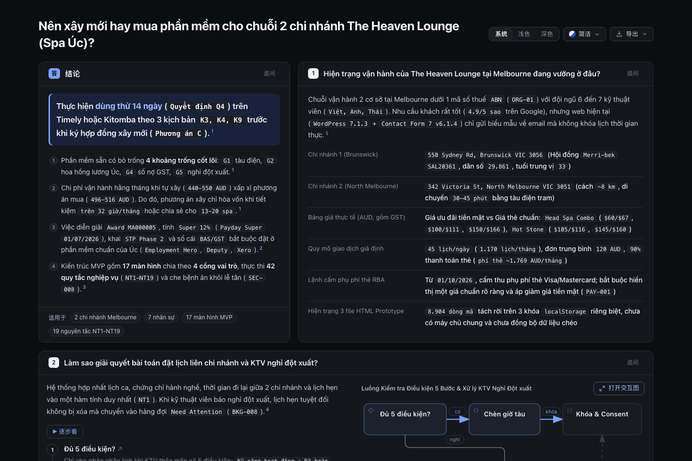](https://htmlpreview.github.io/?https://github.com/tipovuhoa26-sudo/spa-uc-archify/blob/main/00-spa-uc-tong-quan-kien-truc-tieng-viet-explainer.html)

---

### 01. Báo Cáo Điều Hành — Executive White Paper v4.0
- **Mở trang tương tác:** **[01-spa-uc-executive-whitepaper-explainer.html ↗](https://htmlpreview.github.io/?https://github.com/tipovuhoa26-sudo/spa-uc-archify/blob/main/01-spa-uc-executive-whitepaper-explainer.html)**
- **Điểm chính:** Chiến lược một hồ sơ nhân sự duy nhất xuyên 2 chi nhánh Brunswick (`3056`) & North Melbourne (`3051`), tách bạch 5 dòng tiền, GST 2 chế độ (`ATO GSTR 2003/5`) và ranh giới pháp lý bang Victoria (`MA000005`, `Payday Super 12%`, `STP Phase 2`).

[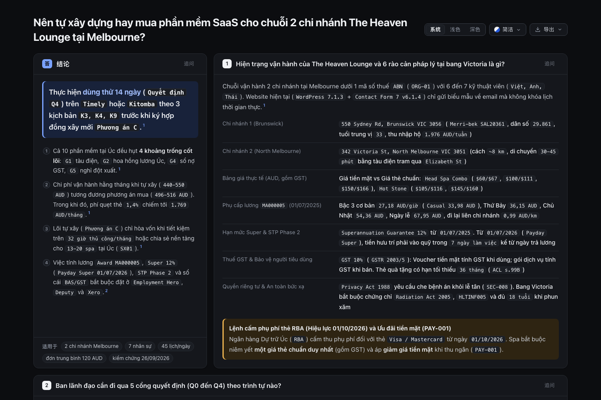](https://htmlpreview.github.io/?https://github.com/tipovuhoa26-sudo/spa-uc-archify/blob/main/01-spa-uc-executive-whitepaper-explainer.html)

---

### 02. Đặc Tả Sản Phẩm & Bản Vẽ Kỹ Thuật MVP (PRD v4.0)
- **Mở trang tương tác:** **[02-spa-uc-mvp-prd-blueprint-explainer.html ↗](https://htmlpreview.github.io/?https://github.com/tipovuhoa26-sudo/spa-uc-archify/blob/main/02-spa-uc-mvp-prd-blueprint-explainer.html)**
- **Điểm chính:** Phân quyền `Role + Scope`, tách biệt bệnh án lâm sàng (`SEC-008`), kiểm tra 5 điều kiện hành nghề (`SKL-003`), giao dịch nguyên tử 6 bước khi `Completed` và lộ trình `R0–R6`.

[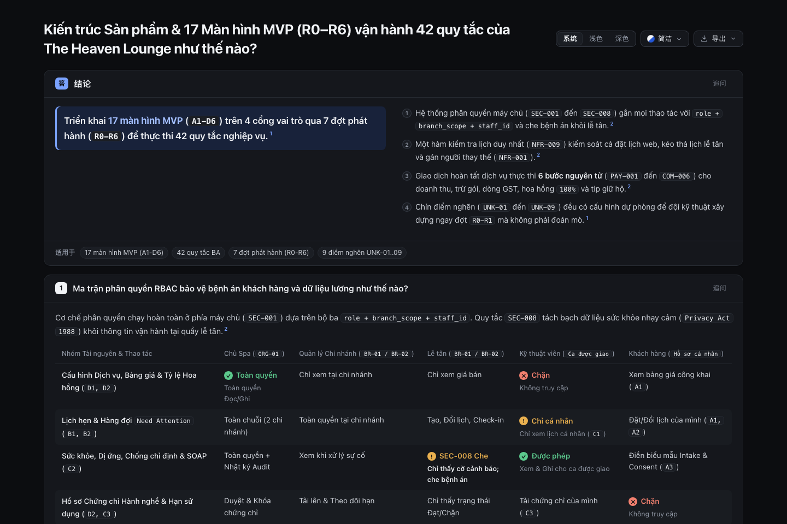](https://htmlpreview.github.io/?https://github.com/tipovuhoa26-sudo/spa-uc-archify/blob/main/02-spa-uc-mvp-prd-blueprint-explainer.html)

---

### 03. Hồ Sơ Bàn Giao Hiện Trạng Prototype (As-Built)
- **Mở trang tương tác:** **[03-spa-uc-prototype-as-built-handover-explainer.html ↗](https://htmlpreview.github.io/?https://github.com/tipovuhoa26-sudo/spa-uc-archify/blob/main/03-spa-uc-prototype-as-built-handover-explainer.html)**
- **Điểm chính:** Kiểm toán 3 file HTML tĩnh (`6.970` dòng mã, `19` màn hình), 3 kho `localStorage` cô lập, 7 cải tiến KTV (`W1–W7`) và 12 hạng mục cần thay thế khi chuyển sang PostgreSQL.

[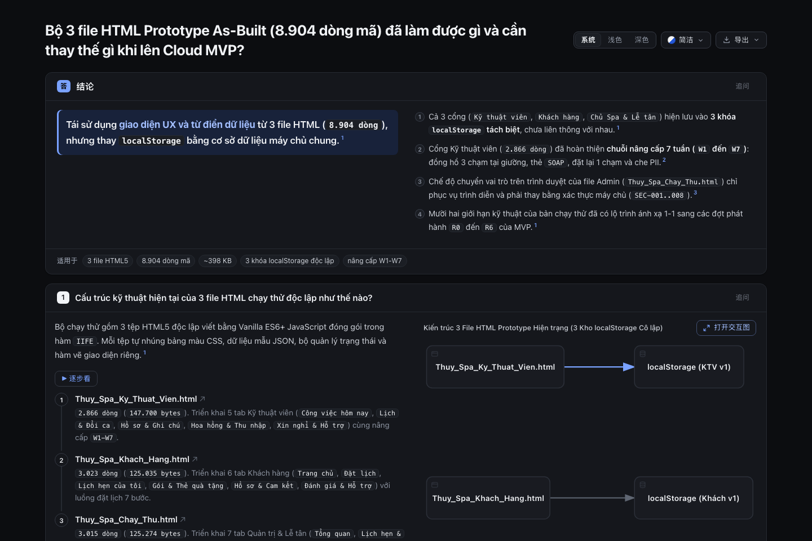](https://htmlpreview.github.io/?https://github.com/tipovuhoa26-sudo/spa-uc-archify/blob/main/03-spa-uc-prototype-as-built-handover-explainer.html)

---

### 04. Kiến Trúc Hệ Thống Đích — Modular Monolith (`architecture`)
- **Mở sơ đồ tương tác (4 Focus Views):** **[04-spa-uc-target-system-architecture.html ↗](https://htmlpreview.github.io/?https://github.com/tipovuhoa26-sudo/spa-uc-archify/blob/main/04-spa-uc-target-system-architecture.html)**
- **Điểm chính:** 4 cổng giao diện (`Portal A/B/C/D`), cổng bảo mật RBAC (`SEC-008`), lõi xử lý đặt lịch + thu ngân + sổ cái PostgreSQL tại AWS Sydney (`ap-southeast-2`), kho bệnh án mã hóa 7 năm và kết nối Xero / Employment Hero / EFTPOS / Twilio AU.

[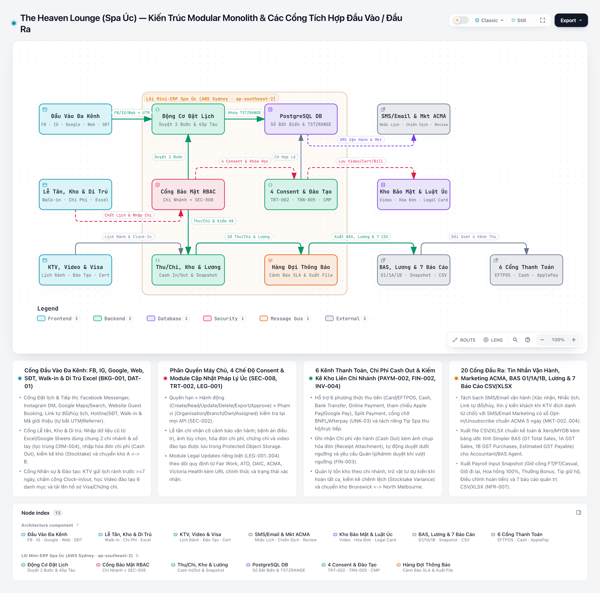](https://htmlpreview.github.io/?https://github.com/tipovuhoa26-sudo/spa-uc-archify/blob/main/04-spa-uc-target-system-architecture.html)

---

### 05. Đối Chiếu Kiến Trúc Prototype và Hệ Thống Đích (`compare`)
- **Mở sơ đồ tương tác (Side-by-Side / Delta Diff):** **[05-spa-uc-asbuilt-vs-target-compare.html ↗](https://htmlpreview.github.io/?https://github.com/tipovuhoa26-sudo/spa-uc-archify/blob/main/05-spa-uc-asbuilt-vs-target-compare.html)**
- **Điểm chính:** Đối chiếu trực quan sự dịch chuyển từ 3 file HTML lưu `localStorage` rời rạc sang kiến trúc Modular Monolith một nguồn dữ liệu gốc duy nhất (`NT11`).

[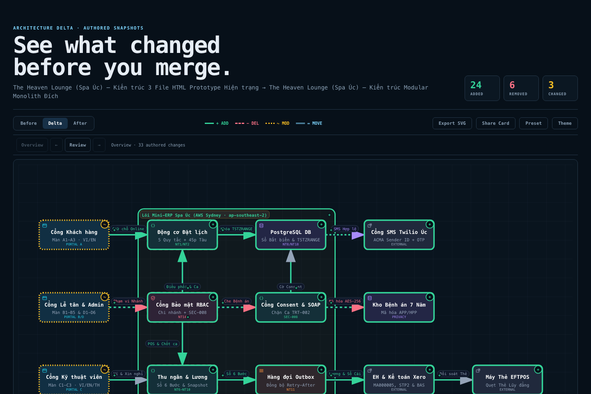](https://htmlpreview.github.io/?https://github.com/tipovuhoa26-sudo/spa-uc-archify/blob/main/05-spa-uc-asbuilt-vs-target-compare.html)

---

### 06. Luồng Đặt Lịch, Chèn Đệm Tram & Nghỉ Đột Xuất (`workflow`)
- **Mở sơ đồ tương tác (2 Focus Views):** **[06-spa-uc-booking-dispatch-workflow.html ↗](https://htmlpreview.github.io/?https://github.com/tipovuhoa26-sudo/spa-uc-archify/blob/main/06-spa-uc-booking-dispatch-workflow.html)**
- **Điểm chính:** Kiểm tra 5 điều kiện (`SKL-003`), tự động chèn `30–45 phút` đi tram liên chi nhánh (`NT2`), khóa `TSTZRANGE` (`NT18`) và phân nhánh xử lý nghỉ đột xuất theo `Selected Therapist` (`BKG-007`) vs `Auto-Assigned` (`BKG-008`).

[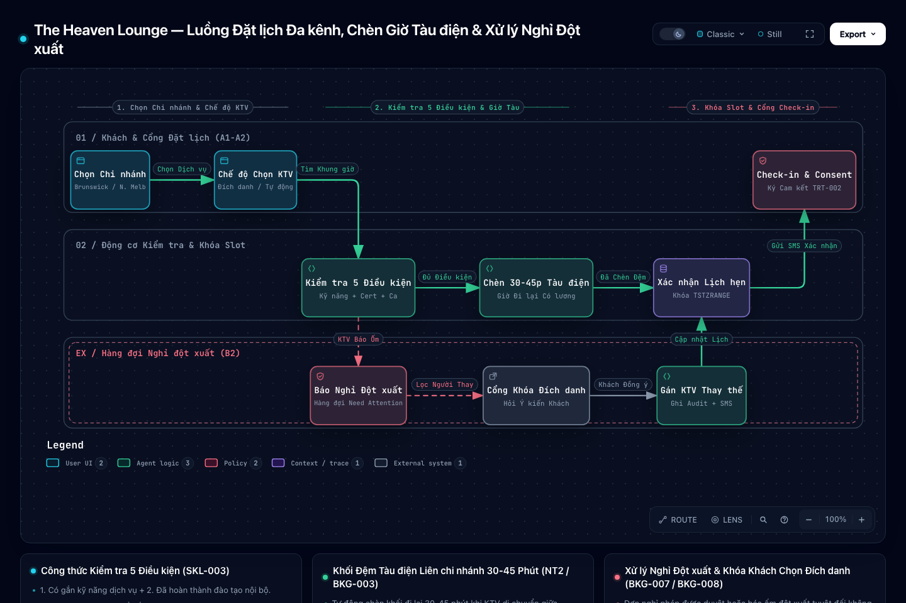](https://htmlpreview.github.io/?https://github.com/tipovuhoa26-sudo/spa-uc-archify/blob/main/06-spa-uc-booking-dispatch-workflow.html)

---

### 07. Vòng Đời Lịch Hẹn & Ràng Buộc Khóa Ca (`lifecycle`)
- **Mở sơ đồ tương tác (3 Focus Views):** **[07-spa-uc-appointment-lifecycle.html ↗](https://htmlpreview.github.io/?https://github.com/tipovuhoa26-sudo/spa-uc-archify/blob/main/07-spa-uc-appointment-lifecycle.html)**
- **Điểm chính:** Máy trạng thái 8 nút (`Booking Request -> Confirmed -> Checked-In -> In Service -> Completed` cùng `Need Attention`, `Waiting for Customer Decision`, `Cancelled / No-Show`) và chốt chặn cấm vào phòng làm dịch vụ khi chưa ký cam kết y khoa (`TRT-002`).

[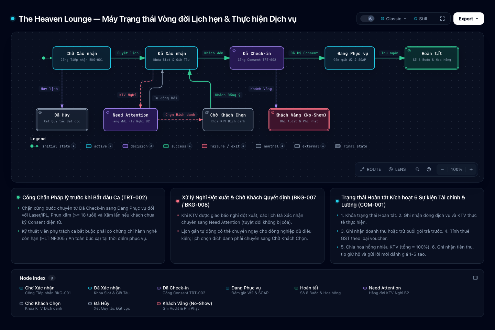](https://htmlpreview.github.io/?https://github.com/tipovuhoa26-sudo/spa-uc-archify/blob/main/07-spa-uc-appointment-lifecycle.html)

---

### 08. Tuần Tự Check-In, Phục Vụ Tại Giường & Tất Toán 6 Bước (`sequence`)
- **Mở sơ đồ tương tác (3 Focus Views):** **[08-spa-uc-service-checkout-sequence.html ↗](https://htmlpreview.github.io/?https://github.com/tipovuhoa26-sudo/spa-uc-archify/blob/main/08-spa-uc-service-checkout-sequence.html)**
- **Điểm chính:** Trình tự phối hợp giữa Khách hàng, Lễ tân POS, Cổng KTV, Lõi Mini-ERP và Sổ cái PostgreSQL qua 3 pha: kiểm tra cam kết đầu vào, đồng hồ 3 chạm tại giường, và giao dịch nguyên tử 6 bước khi thanh toán/hoàn tiền.

[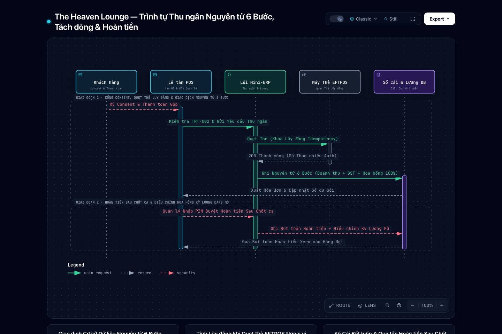](https://htmlpreview.github.io/?https://github.com/tipovuhoa26-sudo/spa-uc-archify/blob/main/08-spa-uc-service-checkout-sequence.html)

---

### 09. Luồng Dữ Liệu Tài Chính, Công Nợ Trả Trước, GST Kép & Bảng Lương (`dataflow`)
- **Mở sơ đồ tương tác (3 Focus Views):** **[09-spa-uc-finance-gst-payroll-dataflow.html ↗](https://htmlpreview.github.io/?https://github.com/tipovuhoa26-sudo/spa-uc-archify/blob/main/09-spa-uc-finance-gst-payroll-dataflow.html)**
- **Điểm chính:** Tách 5 dòng dữ liệu tài chính (`NT6–NT12`): phân loại GST kép (`Monetary Voucher` tính thuế khi dùng vs `Service Package` tính thuế khi bán), sổ cái trả trước Event-Sourced đối soát liên chi nhánh, và khóa sổ `Payroll Input Snapshot` 2 tuần/lần.

[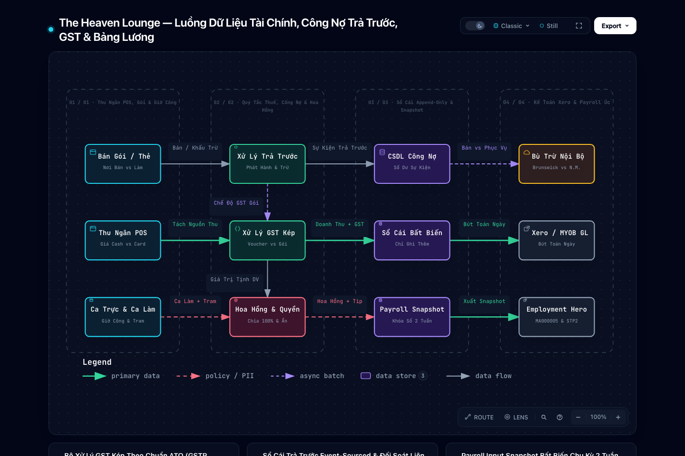](https://htmlpreview.github.io/?https://github.com/tipovuhoa26-sudo/spa-uc-archify/blob/main/09-spa-uc-finance-gst-payroll-dataflow.html)

---

### 10. Sơ Đồ Thực Thể (ERD) Giao Dịch Đa Chi Nhánh & Tuân Thủ (`erd`)
- **Mở sơ đồ tương tác (2 Focus Views):** **[10-spa-uc-core-domain-erd.html ↗](https://htmlpreview.github.io/?https://github.com/tipovuhoa26-sudo/spa-uc-archify/blob/main/10-spa-uc-core-domain-erd.html)**
- **Điểm chính:** 8 thực thể dữ liệu cốt lõi (`branches`, `staff_profiles`, `appointments`, `customers`, `services`, `payroll_snapshots`, `ledger_entries`, `clinical_records`) thực thi khóa nội bộ khách hàng (`NT4`), bảng giá kép (`PAY-001`) và cô lập bệnh án mã hóa (`SEC-008`).

[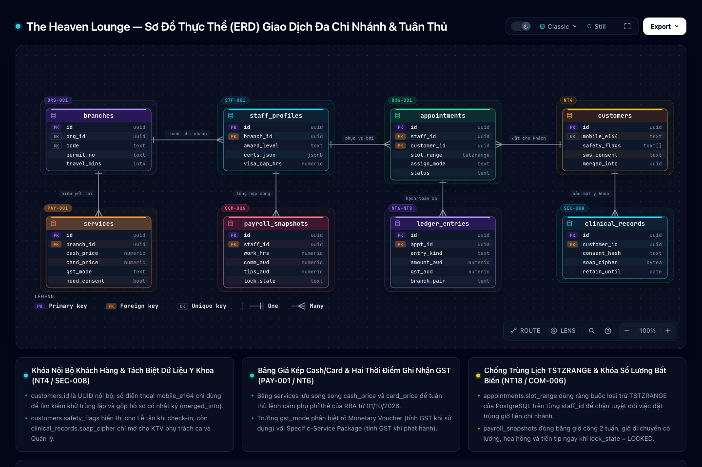](https://htmlpreview.github.io/?https://github.com/tipovuhoa26-sudo/spa-uc-archify/blob/main/10-spa-uc-core-domain-erd.html)

---

### 11. Mô Hình Lớp Kiểm Tra Điều Kiện, Khung Giờ & Hoa Hồng (`class`)
- **Mở sơ đồ tương tác (2 Focus Views):** **[11-spa-uc-eligibility-commission-class.html ↗](https://htmlpreview.github.io/?https://github.com/tipovuhoa26-sudo/spa-uc-archify/blob/main/11-spa-uc-eligibility-commission-class.html)**
- **Điểm chính:** Giao diện mở rộng `SlotValidator` (`NFR-009`) cho phép Giai đoạn 2 cắm thêm kiểm tra phòng/giường/máy (`ResourceSlotRule`) mà không phá vỡ API đặt lịch, cùng lớp `CommissionEngine` chia hoa hồng combo đúng `100%`.

[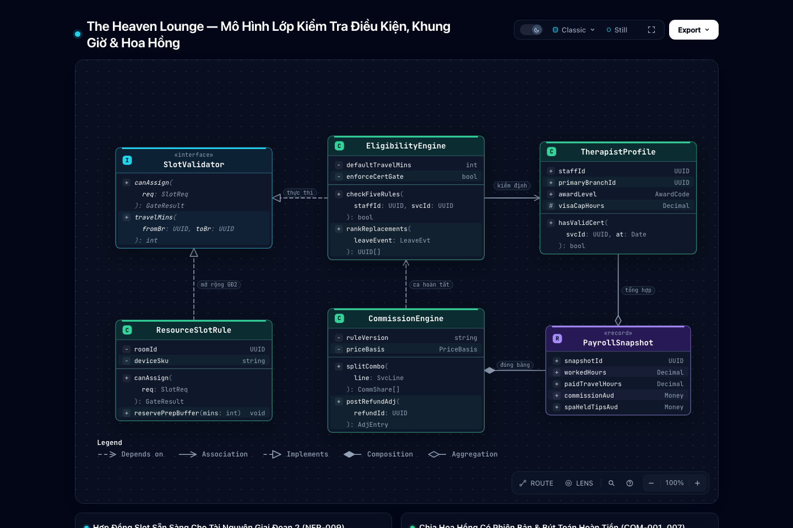](https://htmlpreview.github.io/?https://github.com/tipovuhoa26-sudo/spa-uc-archify/blob/main/11-spa-uc-eligibility-commission-class.html)

---

### 12. Cây Phân Rã Năng Lực Sản Phẩm & 17 Màn Hình MVP (`tree`)
- **Mở sơ đồ tương tác (2 Focus Views):** **[12-spa-uc-capability-module-tree.html ↗](https://htmlpreview.github.io/?https://github.com/tipovuhoa26-sudo/spa-uc-archify/blob/main/12-spa-uc-capability-module-tree.html)**
- **Điểm chính:** Phân rã 4 cổng theo vai trò (`Cổng A: Khách A1–A2`, `Cổng B: Lễ tân B1–B5`, `Cổng C: KTV C1–C4`, `Cổng D: Chủ spa D1–D6`) gắn với các đợt triển khai `R0–R6`.

[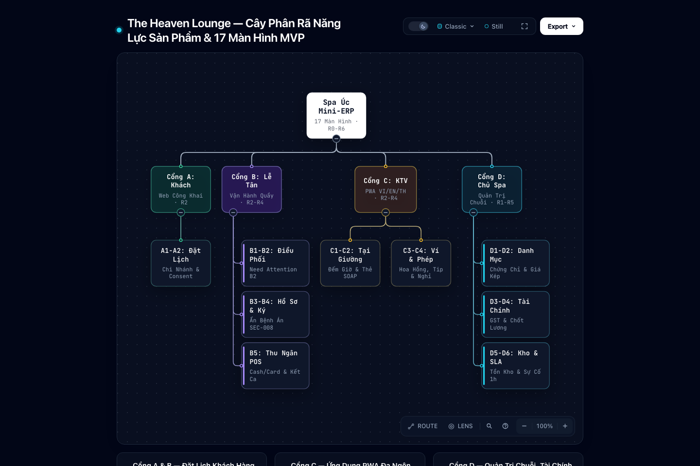](https://htmlpreview.github.io/?https://github.com/tipovuhoa26-sudo/spa-uc-archify/blob/main/12-spa-uc-capability-module-tree.html)

---

### 13. Dòng Thời Gian Nghỉ Đột Xuất Liên Chi Nhánh & SLA Sự Cố 1–2 Sao (`timeline`)
- **Mở sơ đồ tương tác (2 Focus Views):** **[13-spa-uc-incident-sla-timeline.html ↗](https://htmlpreview.github.io/?https://github.com/tipovuhoa26-sudo/spa-uc-archify/blob/main/13-spa-uc-incident-sla-timeline.html)**
- **Điểm chính:** Theo vết ngày vận hành tại Melbourne (`Australia/Melbourne`): xử lý KTV báo nghỉ ốm lúc `08:30`, khóa đệm `45 phút` đi tram có lương lúc `12:15`, và quy trình SLA `1 giờ` điều tra nội bộ khi phát sinh đánh giá 1–2 sao (`REV-001..004`, dữ liệu thời gian minh họa `illustrative`).

[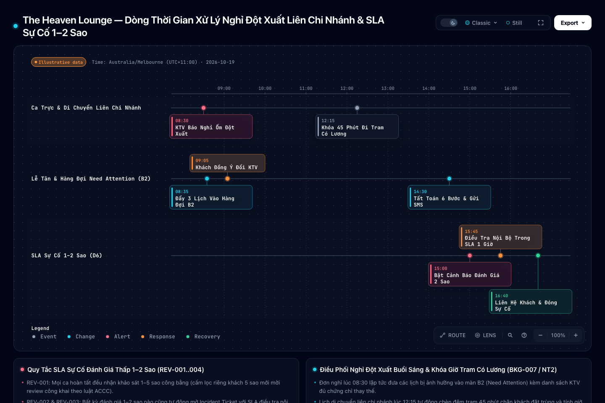](https://htmlpreview.github.io/?https://github.com/tipovuhoa26-sudo/spa-uc-archify/blob/main/13-spa-uc-incident-sla-timeline.html)

---

### 14. Thác Độ Trễ Đặt Lịch Chống Trùng & Khóa Giờ Di Chuyển (`waterfall`)
- **Mở sơ đồ tương tác (2 Focus Views):** **[14-spa-uc-booking-availability-waterfall.html ↗](https://htmlpreview.github.io/?https://github.com/tipovuhoa26-sudo/spa-uc-archify/blob/main/14-spa-uc-booking-availability-waterfall.html)**
- **Điểm chính:** Phân rã ngân sách độ trễ `285ms` (`< 300ms` theo `NFR-001`, dữ liệu minh họa `illustrative`) qua 6 chặng: kiểm tra RBAC (`18ms`), kiểm tra 5 điều kiện (`54ms`), tính giờ tram (`42ms`), khóa `TSTZRANGE` trong PostgreSQL (`88ms`), ghi `AuditLog + SMS Outbox` (`48ms`) và trả kết quả (`19ms`).

[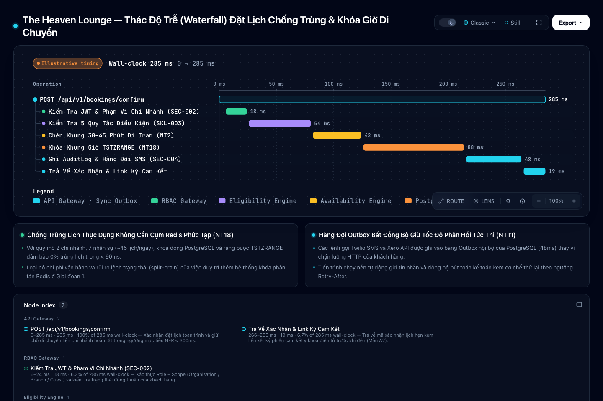](https://htmlpreview.github.io/?https://github.com/tipovuhoa26-sudo/spa-uc-archify/blob/main/14-spa-uc-booking-availability-waterfall.html)
