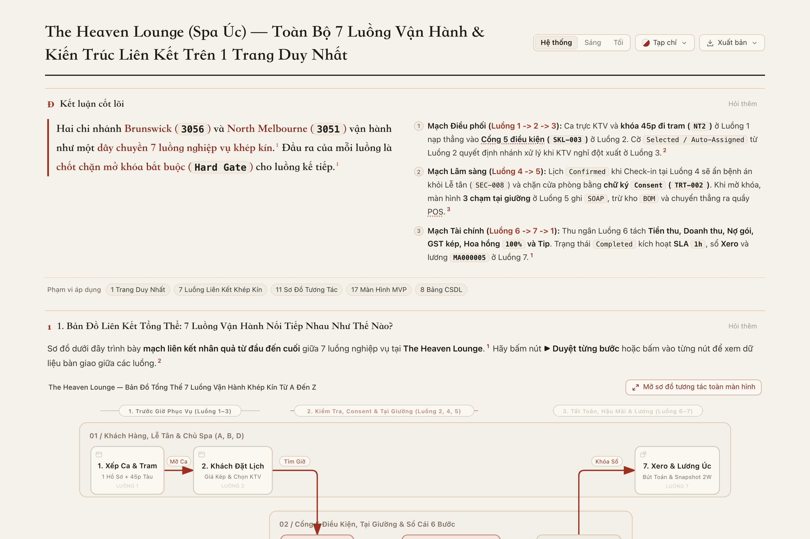
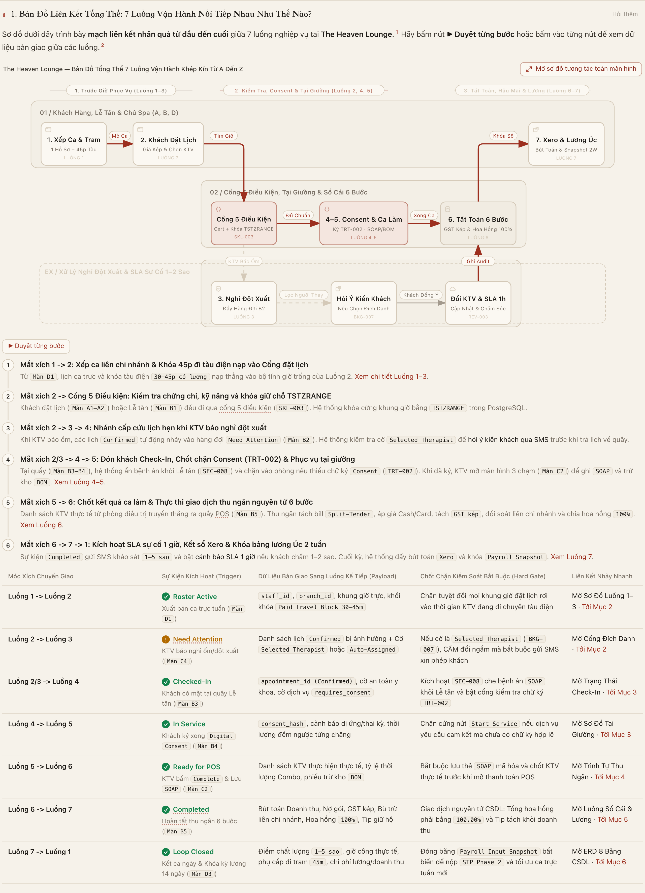
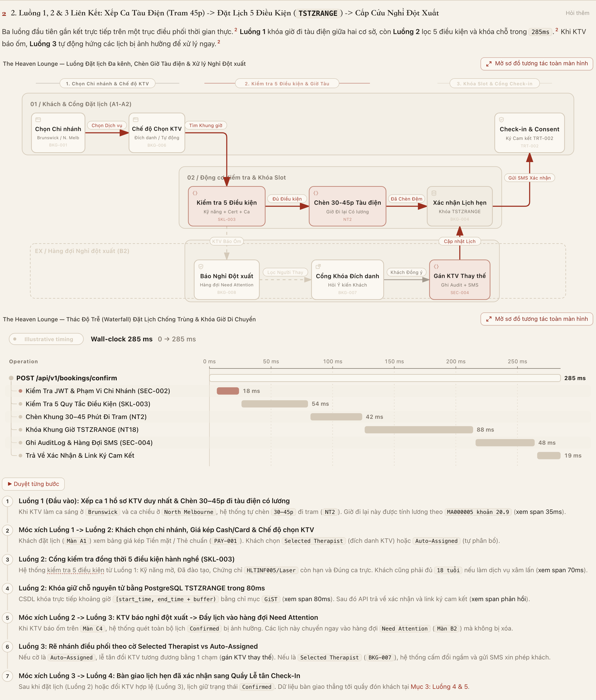
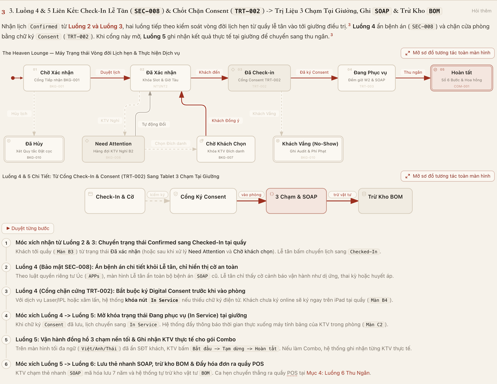
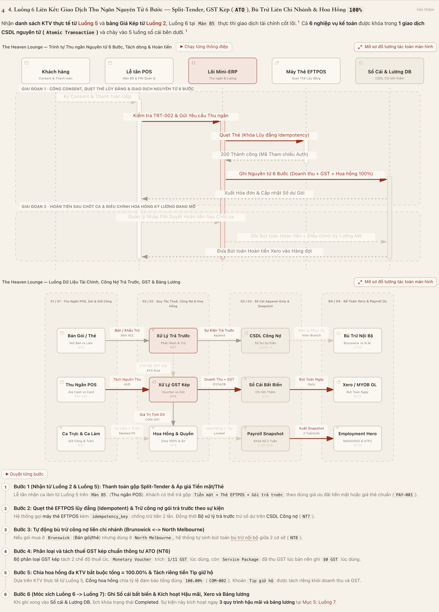
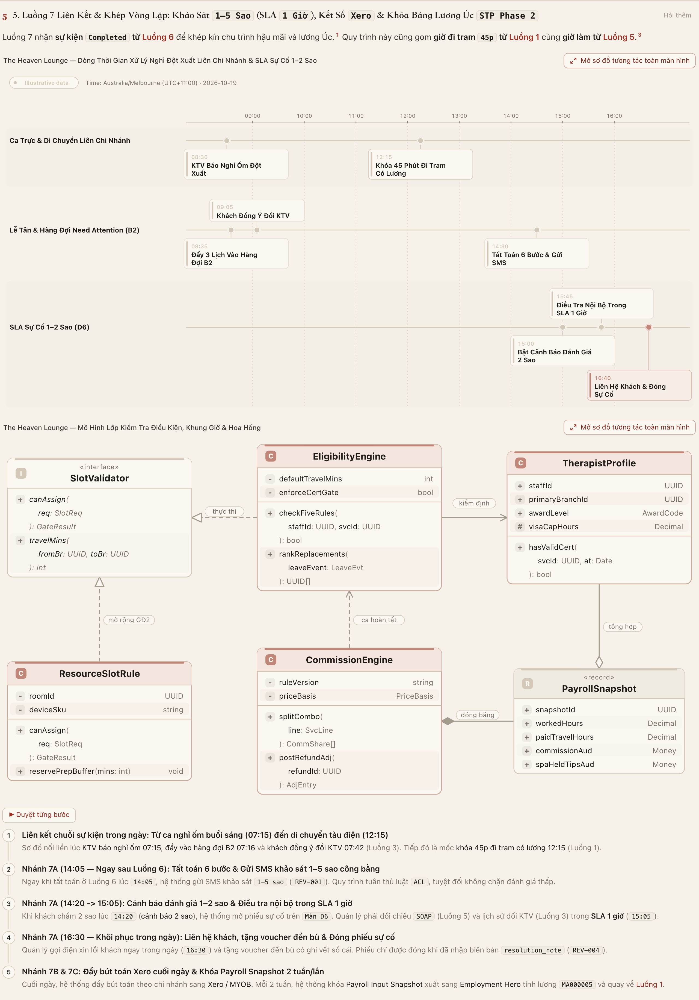
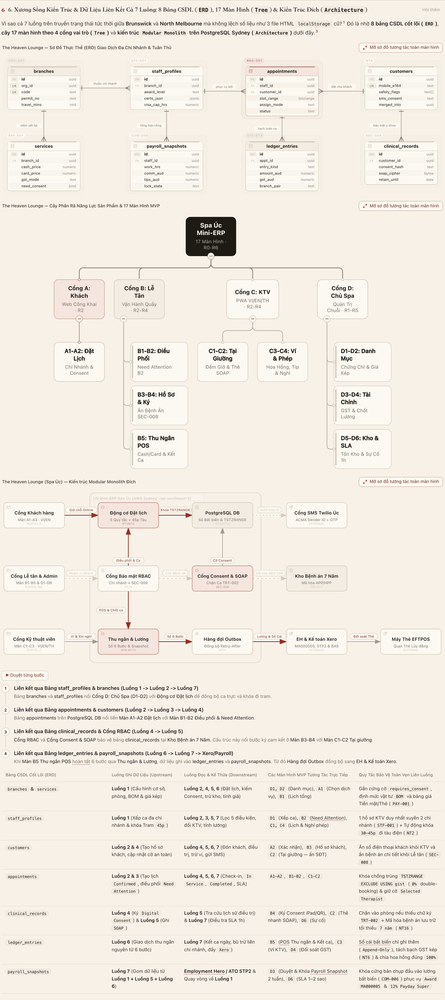

# The Heaven Lounge (Spa Úc) — Toàn Bộ 7 Luồng Vận Hành & Kiến Trúc Liên Kết Trên 1 Trang Duy Nhất

> **1 Trang Tương Tác Duy Nhất (`index.html`) · 100% Tiếng Việt (`0` chữ tiếng Trung) · 7 Luồng Vận Hành Liên Kết Khép Kín · 11 Sơ Đồ Archify Tương Tác · 17 Màn Hình MVP · 8 Bảng CSDL**
>
> **Cơ sở áp dụng:** **Brunswick (`3056`)** & **North Melbourne (`3051`)** — Melbourne, Victoria, Australia  
> **Chuẩn pháp lý Úc:** Fair Work `[MA000005]` (Hair and Beauty Industry Award) · `ATO GST` (`GSTR 2003/5` & `GSTR 2012/1`) · `Privacy Act 1988 (APPs)` · `ACL` · `STP Phase 2` & `12% Payday Super`

---

## 🌐 Mở Ngay Trang Tương Tác Hợp Nhất Duy Nhất (1-Click)

| Trang Hợp Nhất Duy Nhất | Nội Dung Tích Hợp Trên 1 Trang | Mở Trực Tiếp Trên Trình Duyệt | Mã Nguồn HTML |
| :--- | :--- | :--- | :--- |
| **Toàn Bộ 7 Luồng Vận Hành & Kiến Trúc Liên Kết (`index.html`)** | Hợp nhất **cả 7 luồng vận hành liên kết khép kín (`Luồng 1 -> Luồng 7 -> Luồng 1`)**, **bảng Móc Xích Chuyển Giao (`Hard Gates`)**, và **toàn bộ 11 sơ đồ tương tác Archify** trong **1 trang duy nhất** có nút **▶ Duyệt từng bước**, **Mở sơ đồ tương tác toàn màn hình**, **Sáng / Tối** và **Xuất ảnh / PDF** hoàn toàn bằng tiếng Việt. | [**👉 BẤM ĐỂ MỞ TRANG HỢP NHẤT DUY NHẤT (`index.html`)**](https://htmlpreview.github.io/?https://github.com/tipovuhoa26-sudo/spa-uc-archify/blob/main/index.html) | [`index.html`](./index.html) · [`spa-uc-toan-bo-luong-van-hanh-lien-ket.html`](./spa-uc-toan-bo-luong-van-hanh-lien-ket.html) |

---

## 🔗 7 Luồng Vận Hành Liên Kết Với Nhau Như Thế Nào? (Mạch Nhân Quả Khép Kín)

Tại **The Heaven Lounge**, 7 luồng nghiệp vụ **không rời rạc** mà vận hành như một **dây chuyền khép kín** — đầu ra (`Output State & Payload`) của luồng trước là **chốt chặn mở khóa bắt buộc (`Hard Gate`)** cho luồng kế tiếp:

| Móc Xích Liên Kết | Sự Kiện Kích Hoạt (Trigger) | Dữ Liệu Bàn Giao Sang Luồng Kế Tiếp (Payload) | Chốt Chặn Kiểm Soát Bắt Buộc (Hard Gate) |
| :--- | :--- | :--- | :--- |
| **1. Luồng 1 ➔ Luồng 2** *(Xếp ca Tram 45p ➔ Đặt lịch)* | Chủ Spa xuất bản ca trực tuần trên `Màn D1` (`Roster Active`) | `staff_id` (1 hồ sơ KTV duy nhất), `branch_id`, giờ trực và khối khóa **`Paid Travel Block 30–45m`** đi tàu điện giữa Brunswick & North Melbourne | Chặn tuyệt đối mọi khung giờ đặt lịch rơi vào thời gian KTV đang di chuyển tàu điện (`MA000005 khoản 20.9`) |
| **2. Luồng 2 ➔ Luồng 3** *(Đặt lịch 5 điều kiện ➔ Cấp cứu nghỉ đột xuất)* | KTV báo nghỉ ốm/đột xuất trên `Màn C4` (`Need Attention`) | Danh sách lịch `Confirmed` bị ảnh hưởng + Cờ chế độ khách chọn **`Selected Therapist`** (đích danh) hoặc **`Auto-Assigned`** (tự phân bổ) | Nếu cờ là `Selected Therapist` (`BKG-007`), **CẤM tự ý đổi ngầm** mà bắt buộc gửi SMS xin ý kiến khách |
| **3. Luồng 2/3 ➔ Luồng 4** *(Lịch đã xác nhận ➔ Đón khách Check-In)* | Khách có mặt tại quầy Lễ tân trên `Màn B3` (`Checked-In`) | `appointment_id (Confirmed)`, cờ cảnh báo an toàn y khoa (`Allergy / Pregnancy`), cờ dịch vụ `requires_consent` | Kích hoạt **`SEC-008`** ẩn bệnh án `SOAP` chi tiết khỏi Lễ tân và bật cổng kiểm tra chữ ký **`TRT-002`** |
| **4. Luồng 4 ➔ Luồng 5** *(Ký Digital Consent ➔ Trị liệu 3 chạm tại giường)* | Khách ký xong `Digital Consent` trên `Màn B4` (`In Service`) | `consent_hash` bất biến, cảnh báo lâm sàng tại giường, thời lượng đếm ngược từng chặng dịch vụ | **Chặn cứng nút `Start Service`** nếu dịch vụ xâm lấn/Laser yêu cầu cam kết mà chưa có chữ ký hợp lệ |
| **5. Luồng 5 ➔ Luồng 6** *(Hoàn tất tại giường & SOAP ➔ Thu ngân POS 6 bước)* | KTV bấm `Complete` & Lưu thẻ `SOAP` trên `Màn C2` (`Ready for POS`) | Danh sách KTV thực hiện thực tế (cho gói Combo nhiều người làm), tỷ lệ thời lượng thực tế, phiếu trừ kho `BOM` | Bắt buộc lưu thẻ `SOAP` mã hóa (lưu trữ 7 năm) và chốt KTV thực tế trước khi mở màn hình thu ngân `Màn B5` |
| **6. Luồng 6 ➔ Luồng 7** *(Thu ngân 6 bước ➔ Hậu mãi SLA 1h, Xero & Lương Úc)* | Lễ tân hoàn tất thanh toán 6 bước trên `Màn B5` (`Completed`) | Bút toán Doanh thu, Công nợ gói trả trước, **GST kép (`ATO`)**, Bù trừ liên chi nhánh, **Hoa hồng `100.00%`** và **Tip giữ hộ** | Giao dịch CSDL nguyên tử (`Atomic Transaction`): Tổng hoa hồng bắt buộc bằng `100.00%` và Tip tách khỏi doanh thu |
| **7. Luồng 7 ➔ Luồng 1** *(Khóa sổ Xero & Lương 2 tuần ➔ Tối ưu ca trực tuần mới)* | Kết ca ngày & Khóa kỳ lương 14 ngày trên `Màn D3` (`Loop Closed`) | Điểm chất lượng `1–5 sao`, giờ công thực tế, phụ cấp đi tram `45m`, tỷ lệ chi phí lương / doanh thu từng cơ sở | Đóng băng **`Payroll Input Snapshot`** bất biến để nộp `STP Phase 2`, trả `12% Payday Super` và tối ưu ca trực tuần kế tiếp |

---

## 🗺️ Xem Trực Tiếp 6 Mục Liên Kết Trên Trang Hợp Nhất (`index.html`)

### Mục 1. Bản Đồ Liên Kết Tổng Thể 7 Luồng & Bảng Móc Xích Chuyển Giao (`Hard Gates`)
- **Mở trực tiếp trên trang hợp nhất:** [**Mục 1 — Bản Đồ Liên Kết 7 Luồng (`#ban-do-lien-ket-7-luong`)**](https://htmlpreview.github.io/?https://github.com/tipovuhoa26-sudo/spa-uc-archify/blob/main/index.html#ban-do-lien-ket-7-luong)

---

### Mục 2. Luồng 1, 2 & 3 Liên Kết: Xếp Ca Tàu Điện (Tram 45p) ➔ Đặt Lịch 5 Điều Kiện (`TSTZRANGE 285ms`) ➔ Cấp Cứu Nghỉ Đột Xuất
- **Mở trực tiếp trên trang hợp nhất:** [**Mục 2 — Luồng 1, 2 & 3 Liên Kết (`#luong-1-2-3-xep-ca-dat-lich-cap-cuu`)**](https://htmlpreview.github.io/?https://github.com/tipovuhoa26-sudo/spa-uc-archify/blob/main/index.html#luong-1-2-3-xep-ca-dat-lich-cap-cuu)

---

### Mục 3. Luồng 4 & 5 Liên Kết: Check-In Lễ Tân (`SEC-008`) & Chốt Chặn Consent (`TRT-002`) ➔ Trị Liệu 3 Chạm Tại Giường, Ghi `SOAP` & Trừ Kho `BOM`
- **Mở trực tiếp trên trang hợp nhất:** [**Mục 3 — Luồng 4 & 5 Liên Kết (`#luong-4-5-checkin-consent-tai-giuong`)**](https://htmlpreview.github.io/?https://github.com/tipovuhoa26-sudo/spa-uc-archify/blob/main/index.html#luong-4-5-checkin-consent-tai-giuong)

---

### Mục 4. Luồng 6 Liên Kết: Giao Dịch Thu Ngân Nguyên Tử 6 Bước — Split-Tender, GST Kép (`ATO`), Bù Trừ Liên Chi Nhánh & Hoa Hồng `100%`
- **Mở trực tiếp trên trang hợp nhất:** [**Mục 4 — Luồng 6 Thu Ngân 6 Bước (`#luong-6-thu-ngan-6-buoc-gst-hoa-hong`)**](https://htmlpreview.github.io/?https://github.com/tipovuhoa26-sudo/spa-uc-archify/blob/main/index.html#luong-6-thu-ngan-6-buoc-gst-hoa-hong)

---

### Mục 5. Luồng 7 Liên Kết & Khép Vòng Lặp: Khảo Sát `1–5 Sao` (SLA `1 Giờ`), Kết Sổ `Xero` & Khóa Bảng Lương Úc `STP Phase 2`
- **Mở trực tiếp trên trang hợp nhất:** [**Mục 5 — Luồng 7 Hậu Mãi, Xero & Lương Úc (`#luong-7-hau-mai-sla-xero-payroll`)**](https://htmlpreview.github.io/?https://github.com/tipovuhoa26-sudo/spa-uc-archify/blob/main/index.html#luong-7-hau-mai-sla-xero-payroll)

---

### Mục 6. Xương Sống Kiến Trúc & Dữ Liệu Liên Kết Cả 7 Luồng: 8 Bảng CSDL (`ERD`), 17 Màn Hình (`Tree`) & Kiến Trúc Đích (`Architecture`)
- **Mở trực tiếp trên trang hợp nhất:** [**Mục 6 — Kiến Trúc, ERD & 17 Màn Hình Liên Kết (`#kien-truc-du-lieu-va-17-man-hinh-lien-ket`)**](https://htmlpreview.github.io/?https://github.com/tipovuhoa26-sudo/spa-uc-archify/blob/main/index.html#kien-truc-du-lieu-va-17-man-hinh-lien-ket)

---

## 📁 Cấu Trúc Thư Mục

- [`index.html`](./index.html) / [`spa-uc-toan-bo-luong-van-hanh-lien-ket.html`](./spa-uc-toan-bo-luong-van-hanh-lien-ket.html) — **Trang tương tác hợp nhất duy nhất** tích hợp toàn bộ 7 luồng vận hành liên kết và 11 sơ đồ Archify (100% tiếng Việt, `0` lỗi, `0` cảnh báo).
- [`sources/spa-uc-toan-bo-luong-van-hanh-lien-ket.archify.md`](./sources/spa-uc-toan-bo-luong-van-hanh-lien-ket.archify.md) — Mã nguồn Archify Explainer của trang hợp nhất kèm các sơ đồ JSON (`sources/*.json`).
- [`previews/`](./previews/) — Ảnh chụp trực quan độ phân giải cao của trang hợp nhất và 6 mục liên kết.
